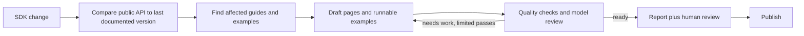

# Brief: an automated doc system for SDKs

*A longer explanation for writers, managers, and partner teams. Draft for review.*

## 1. Why this exists

An SDK's reference pages can be generated from its code. The pages that help people succeed cannot:
the concepts that explain how it works, the how-to guides, and the examples that people copy and run.
Those are written by hand, and they fall behind when the SDK changes.

The goal of this proof of concept is to test one idea: can a system watch an SDK, notice what changed,
and help produce those teaching pages and examples, while keeping people in control of what ships?

## 2. The idea in plain terms

Think of a careful assistant with a checklist. When the SDK changes, the assistant:

- compares the SDK's public interface to the last version we documented,
- looks up which guides and examples talk about the parts that changed,
- drafts updates and new examples,
- checks the drafts against rules and against the real interface,
- reports what it did and what it could not check.

A person reviews the result before anything is published.

## 3. How it works

Four parts do the work:

- **A map of the docs.** One file lists every guide and example, what each covers, and the key
  features each must explain. This is how a change finds the pages it affects.
- **Separate example code.** Each example is a small, complete script in its own file. A guide refers
  to named parts of it, and the code is pulled in when the page is built. That means examples can be
  tested, updated, and reused without editing the pages.
- **Quality checks.** Automatic rules catch problems such as code pasted into a page, made-up feature
  names, or an example that would not run as a script. A model-based reviewer scores accuracy, clarity,
  teaching value, and completeness against the real interface.
- **A limited improvement loop.** If a draft falls short, the system tries a few improvements and keeps
  the best version. It stops when more passes stop helping. Each page gets a report that says why it
  stopped, and what was not checked.

## 4. What we have learned so far

- **The reviewer is useful, with limits.** It found real gaps in our drafts: examples that could
  delete data they had not created, missing error handling, and wording that was wrong. We fixed those.
  It also made wrong calls when it could not see enough detail, so findings need checking.
- **A passing score does not mean a draft is right.** An early automatic rewrite replaced an SDK feature
  with hand-written code and added a claim nobody could verify. The reviewer scored it fine. This is
  why a person stays the final judge.
- **The system found mistakes in the SDK's own docs.** Some documented return values and options do
  not match what the code does. We recorded them and have not reported them.

## 5. What is proven and what is not

| Proven | Not yet proven |
|---|---|
| Detecting what changed and routing it to the right pages | Writing guides from scratch at scale |
| Keeping example code in separate files that are checked automatically | Running the examples against a live Splunk |
| Automatic checks that fail on bad input | Publishing to the developer site |
| A reviewer with bounded passes and clear reports | Cost and quality across many SDKs |

## 6. How it fits with other work

- **Reference to GitHub Pages.** A separate effort is moving SDK reference pages to GitHub Pages.
  Our system produces the same kind of reference, and the two efforts will join later.
- **Guides to dev.splunk.com.** That site's source is Markdown, so publishing our pages is mostly
  translation, not conversion.
- **The SplunkUI documentation build.** It extracts and packages component docs and produces
  LLM-friendly exports. We plan to adopt their export convention, and we build the parts it does not
  do. A log records each reuse decision and why.

## 7. Risks and how we handle them

- **Over-trusting the model.** People review and publish. Reports say what was not checked.
- **Wrong or made-up details.** Automatic checks compare named features to the real interface, and
  examples are checked automatically for syntax, style, and real feature names. Running them against a live Splunk is the next step.
- **Content damaged by automatic rewrites.** The loop currently edits files in place. We plan to change
  it to propose changes for review.
- **Cost.** Runs are small. A usage meter shows what each run uses.

## 8. What comes next

1. Finish the first version: safer improvement loop, a first run that writes guides from scratch, and
   cost controls.
2. Test examples against a running Splunk.
3. Publish: reference to GitHub Pages and guides to the developer site.
4. Use what we learn to apply the system to a second SDK.
